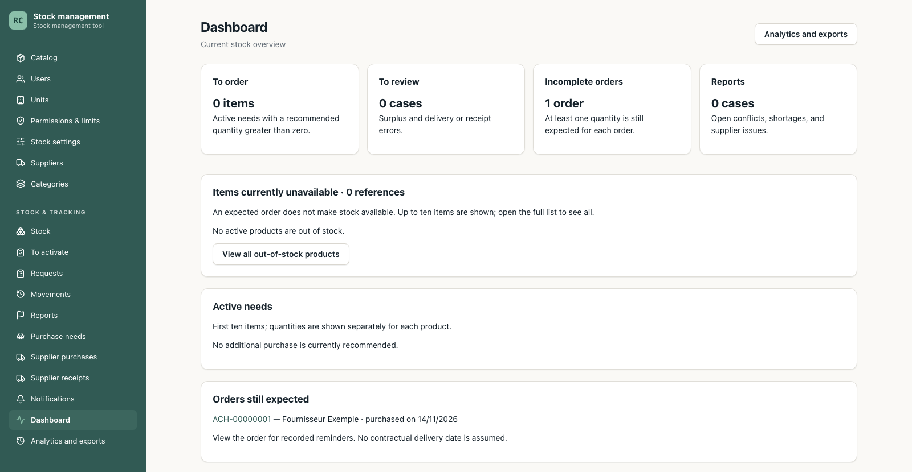
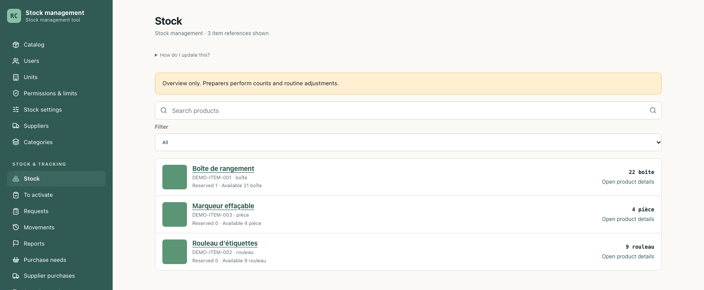
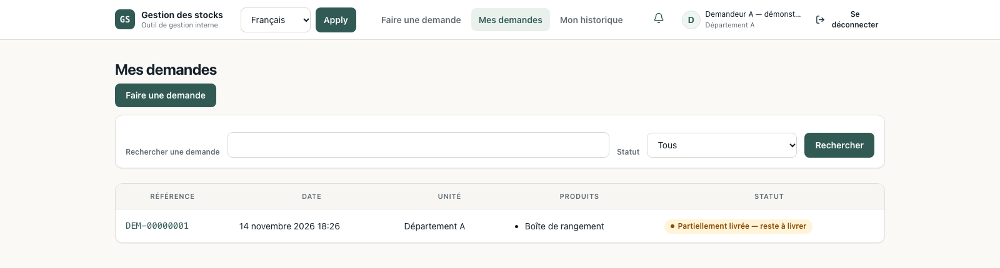
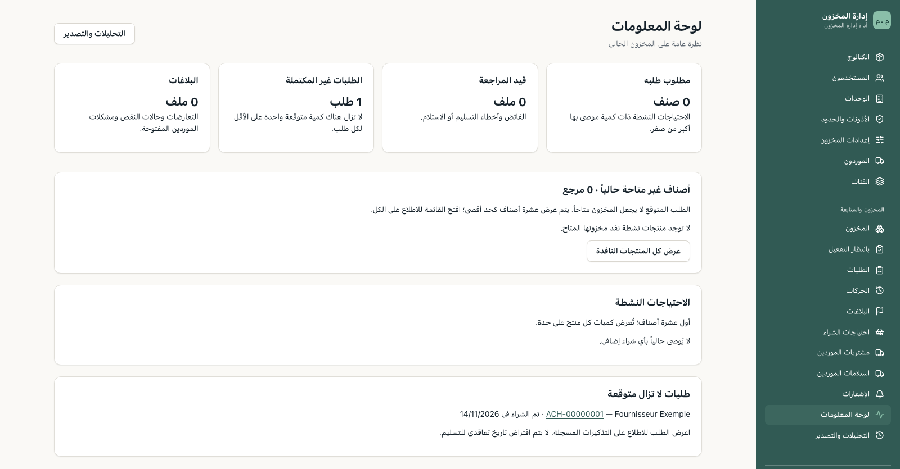

# Réserve centrale

**Open-source inventory and internal supply management for organisations.**

Réserve centrale is a self-hosted application for teams that manage shared stock and internal supply requests. It records stock, reservations, distributions, supplier orders and receipts in one traceable workspace.

[View the v0.1.0 experimental release](https://github.com/ilias972/reserve-centrale/releases/tag/v0.1.0)

## Screenshots

### Dashboard — English



### Inventory — English



### Internal requests — French



### Dashboard — Arabic, right to left



All screenshots were captured from the application using its optional fictitious demo data. They contain no organisation data.

## Key features

- Inventory tracking and stock movement history.
- Reservations and available-stock calculations.
- Internal supply requests, preparation and full or partial distribution.
- Supplier orders entered by a manager and receipt tracking.
- User roles, department access and quantity limits.
- Audit history, operational dashboards, statistics and XLSX exports.
- English, French and Modern Standard Arabic interface, including RTL layout.

## How it works

1. A manager configures items, departments and access limits.
2. A requester submits an internal request.
3. The application reserves available quantities as part of the request transaction.
4. An operator prepares the request and records the quantities distributed.
5. Stock balances and the related history reflect the confirmed operation.

This is an overview of the common path; the application also supports partial issues, corrections, receipts and exception handling. A distribution to a department is not a measurement of what that department consumed.

## Try it locally

The project is intended to be installed as a dedicated instance for one organisation. A local demo requires **Python 3.13**, **PostgreSQL**, **GNU gettext** and separate PostgreSQL owner, runtime and test roles. The setup is not a one-command demo: follow the verified steps in [Local installation](docs/INSTALLATION.md), then optionally create fictitious data with [Fictitious demo](docs/DEMO.md).

The demo generator prints random passwords once for its fictional accounts. There are no shared or preconfigured demo passwords.

## Supported languages

- English (default for a new installation)
- Français
- العربية — Modern Standard Arabic with right-to-left layout

Users can choose their interface language. Names entered by an organisation, such as item and supplier names, remain as stored. See the [translation workflow](docs/TRANSLATIONS.md).

## Tests and quality checks

Tests require a local PostgreSQL instance and a dedicated test role that can create temporary `test_stock_app_*` databases. They never use the demo or a production database. See [Local installation](docs/INSTALLATION.md) for the role setup.

```sh
DATABASE_NAME=postgres TEST_DATABASE_NAME=test_stock_app_local \
  .venv/bin/python manage.py test tests --settings=config.settings.test --noinput --verbosity=2
make quality
```

Tests keep email local and simulate push delivery; external email and Web Push transports are disabled.

## Architecture

Réserve centrale is a server-rendered Django monolith backed by PostgreSQL. JavaScript enhances selected forms and navigation. PostgreSQL transactions protect stock-changing workflows; the database remains the source of truth. See [Architecture](docs/ARCHITECTURE.md) for the module boundaries and invariants.

## Contributing

Bug reports, documentation improvements, focused fixes and translation contributions are welcome. Read [CONTRIBUTING.md](CONTRIBUTING.md) before opening an issue or pull request. Please use only fictitious data in reports and screenshots.

## Limitations

- One organisation per installation; this is not a multi-tenant SaaS.
- The application has not been validated for every organisation or regulated workflow and does not claim medical-regulatory certification.
- A real deployment needs environment-specific security, TLS, backups, monitoring, retention and update procedures. The local Django development server is not a production server.
- Email and Web Push transports are disabled by default. Physical iPhone Web Push delivery has not been generally validated.
- Human review of the Arabic terminology is recommended.
- No production availability or support guarantee is provided.

See [Limitations](docs/LIMITATIONS.md) before evaluating the software for operational use.

## License, third-party notices and security

The project code identified in [`LICENSE`](LICENSE) is offered under the MIT License. Third-party components retain their own licences and required notices; see [`THIRD_PARTY_NOTICES.md`](THIRD_PARTY_NOTICES.md). The project licence does not replace third-party terms.

For sensitive vulnerability reports, use the repository's [private vulnerability reporting](https://github.com/ilias972/reserve-centrale/security/advisories/new). See [`SECURITY.md`](SECURITY.md).
